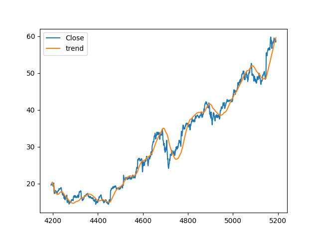

# Kur Krizi Alarmı 

Sabitlenmiş bir kur devaluasyon yasamaya yakın mıdır? Bir ülkenin kur
krizi yaşama ihtimali nedir? The Global Macro Database [1] adı verilen
veriyi kullanarak kriz tahmini yapma amaçlı bir gösterge (indicator)
takip eden / saptayıcı / tahminci yazılımı paylaşacağız.

GMD verisi IMF, Dünya Bankası, OECD verilerini birleştirir ve finans,
kur krizlerini etiketleyerek araştırmacıların rahatça erisebileceği
bir kaynak sağlar. Veriyi direk [2]'den zip / csv olarak
indirebiliriz. Bir diğer yöntem,

```
pip install global_macro_data
```

sonrası

```python
from global_macro_data import gmd
df = gmd(fast="yes")
df.to_csv('/opt/Downloads/gmd/gmd.csv')
```

Bu yöntem eğer güncel yeni veri varsa en son versiyonu indirir, yoksa
eski versiyonu tutar, veri indirmesi olmaz.

Tasarım

Yaklaşmakta olan krizlerin farklı önden gelen göstergeleri (leading
indicator) olabilir. Altta tahmin amaçlı bizim kullandıklarımızı
altta, onları saptarken [3,4] yazılarını temel aldık.

Tahmin amacıyla lojistik regresyon istatistik yöntemini baz aldık. Bir
senedeki (birazdan listeleyeceğimiz) değişkenler bir *sonraki*
senedeki kriz varlığı (1/0) ile regresyona verilecek. Kriz kolonu
GMD'de `CurrencyCrisis`. Ardından tanımladığımız değişkenlerin
katsayıları bir sonraki adımda tahmin amaçlı kullanılabilecek, tahmini
istenen T senesi ise T-1 senesindeki değişkenlerin değerleri
katsayıları ile birlikte lojistik formülüne sorulacak. Bu formül tüm
katsayıları ile birlikte şu şekilde,

$$\left(
\text{Crisis}_{t+1}=1\right)=
\sigma\left(
    \beta_0 +
    \beta_{1} z^{\text{ca}} +
    \beta_{2} z^{\text{rer_dev}} +
    \beta_{3} z^{\text{exports}} +
    \beta_{4} z^{\text{output}} +
    \beta_{5} z^{\text{infl}} +
    \beta_{6} z^{\text{credit}}
\right)$$

$$\sigma(u)=\frac{1}{1+e^{-u}}$$

Değişkenler

Değişken: `ca`, Cari İşlemler Hesabı (Current Account)

GMD'deki `CA_GDP` kolonunu baz alır, bu kolon cari işlemler hesabının
gayrisafi yurtiçi hasılasına (GDP) göre oranıdır. Risk artışını
hesaplamaya uğraştığımız için kod içinde kolonun negatifi alındı
`(-g["CA_GDP"])`. Cari işlemler hesabı bir ülkenin ticaret dengesini
gösterir, ve net olarak dışarıdan ne kadar getiri elde edildiğini
kayıtlar. Eğer cari işlemler hesabında kayıp var ise bu bir ülkenin
dışarıdan kazandığından daha fazlasını dışarı ödediği anlamına gelir,
ve farkı kapatmak için dış sermaye akışına ihtiyaç duyar / onu
kullanır. Negatif alarak cari açığı (negatif değer) pozitif bir risk
seviyesine çeviriyoruz, çünkü dış sermayenin birden bire durması
mümkündür bu da ülkenin kuru üzerinde bir risk yaratır.

Değişken: `rer_dev`, gerçek döviz kuru trendinden sapma (Real Exchange
Rate Deviation)

Bu hesabı yapmadan önce onun baz aldığı `rer` nasıl hesaplanır onu
görelim. Kriz tahmini için yayınlanan döviz kuru rakamı tabii ki
yeterli değil, zaten yeterli olsaydı bu belgede anlatılan tüm
taklalara gerek kalmazdı. Saptanmaya uğraşılan bir ülke kurunun
özellikle sabitlenmiş rejimlerde suni olarak belli seviyelerde
olmaları fakat makro ekonomik olaylar sebebiyle savunulamayacak hale
gelmesi ve devalüasyon durumu... Bu durumda, listelenen kur tabii ki
tahmin için yeterli değil çünkü kontrol edilen kur doğal makroekonomik
anlamda doğru değil.

O zaman "gerçek" kuru nasıl hesaplarız? Bir ülkenin fiyat seviyesini
mesela ABD fiyat seviyesi ile karşılaştırabiliriz. Eğer bir ülkenin
fiyat seviyesi `CPI` ise onu ABD ile `US_CPI` / `CPI` formülüyle
karşılaştırabiliriz. `CPI` ekonomi çalışanların bilebileceği üzere
hayali bir alışveriş sepetini doldurmanın kaça mal olacağını
hesaplar. Gündelik ihtiyaçlar, yiyecek, içecek, ev kirası, giyim,
vs. gibi pek çok alım kalemi onun içinde mevcuttur. Dikkat, CPI
enflasyon hesabı degildir, enflasyon bu sepetin yıldan yıla değişimi
üzerinden hesaplanır.

Şimdi `rer` hesabına gelelim, her $t$ senesi için

$$
\text{RER}_t = \frac{\text{USDfx}_t\times \text{US_CPI}_t}{\text{CPI}_t}
$$

$\text{USDfx}_t$: Aktif (nominal) doviz kuru

$\text{US_CPI}_t$: ABD fiyat seviyesi

$\text{CPI}_t$: Yerel fiyat seviyesi

Yerel denilen ülke hangi ülkeyi analiz ediyorsak odur, eğer Arjantin'e
inceleniyorsa onun fiyat seviyesinin ABD fiyat seviyesine (aktif kur
üzerinden ABD yerele çevirildikten sonra) oranına bakılır. Burada
yakalanmaya uğraşılan sinyaller var; eğer yerel enflasyon ABD
enflasyonundan daha fazla artmışsa (oran büyümüşse) yerel ürünler
yabancı ürünlere göre daha pahalı hale gelmiştir. Fakat diyelim ki
aktif döviz kuru bu enflasyon göz önüne alarak değiştirilmiş, bu
durumda reel alım gücü oranı sabit kalabilir.

Ya da yerel enflasyon çok artmıştır, ama hükümet ya da yerel merkez
bankası suni olarak aktif döviz kurunu yanlış yerde sabitlemiş
olabilir, bu durumda yerel ürünler dolar bazında çok pahalı hale
gelir, ve ülkenin uluslararası rekabetçiliği zarar görür, ticari
dengesi bozulur, gerçek döviz kuru (yani `rer`) çok yükselir. Bu
sinyal analiz için faydalı olacaktır. Ülke ekonomisine zarar veren
eylemler krize yol açma potansiyeli olan anlara işaret edebilir.

Fakat salt `rer` tek başına yeterli değil. Ülkelerin ABD'ye göre kur
seviyeleri, oran olarak hesaplamış olsak bile, birbirinden değişik
olabilir, herkesin fiyat seviyesi farklıdır. O zaman tüm ülkeleri
kapsayacak `rer` bazlı bir regresyon iyi sonuç vermez.  Fakat her ülke
için farklı olsa da `rer`'den sapma kalıplarına odaklanırsak, daha
faydalı bir sinyal çıkartabiliriz. İşte `rer_dev` burada devreye
girer. Bir trend hesaplarız, o trend'den sapmayı sinyal haline
getiririz.

Trend hesabını kaydırılan pencereler üzerinde lineer regresyon ile
hesaplayabiliriz. Altta bu hesabı örnek bir zaman serisi üzerinde
görüyoruz (Amazon şirketinin senet fiyatı),

```python
import pandas as pd

def rolling_trend(x):
    mask = ~np.isnan(x)
    if mask.sum() < 5: return np.nan
    X = np.arange(len(x))[mask]
    Y = x[mask]
    p = np.polyfit(X, Y, 1)
    return np.polyval(p, len(x) - 1)
```

```python
df = pd.read_csv('../../../tser/tser_008_data/AMZN.csv').tail(1000)
df['trend'] = df.Close.rolling(window=100, min_periods=5).apply(rolling_trend, raw=True)
df.plot()
plt.savefig('curr_01.jpg')
```




[devam edecek]

Kaynaklar

[1] <a href="https://github.com/KMueller-Lab/Global-Macro-Database">GMD Github</a>

[2] <a href="https://www.globalmacrodata.com/">GMD</a>

[3] <a href="https://www.globalmacrodata.com/research-paper.html">GMD Makalesi</a>

[4] Reinhart, <a href="https://www.imf.org/external/pubs/ft/staffp/1998/03-98/pdf/kaminsky.pdf">Leading Indicators of Currency Crises</a>

