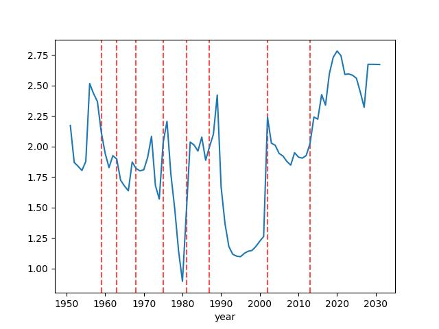

# Kur Krizi Alarmı 

Sabitlenmiş bir kur devaluasyon yasamaya yakın mıdır? Bir ülkenin kur
krizi yaşama ihtimali nedir? The Global Macro Database [1] adı verilen
veriyi kullanarak kriz tahmini yapma amaçlı bir gösterge (indicator)
takip eden / saptayıcı / tahminci yazılımı paylaşacağız. GMD verisi
IMF, Dünya Bankası, OECD verilerini birleştirir ve finans, kur
krizlerini etiketleyerek araştırmacıların rahatça erişebileceği bir
kaynak sağlar. GMD her çeyrekte güncellenir. Veriyi direk [2]'den zip
/ csv olarak indirebiliriz. Bir diğer yöntem,

```
pip install global_macro_data
```

sonrası

```python
from global_macro_data import gmd
df = gmd(fast="yes")
df.to_csv('/opt/Downloads/gmd/gmd.csv')
```

Bu yöntem eğer güncel yeni veri varsa en son versiyonu indirir, yoksa
eski versiyonu tutar, veri indirmesi olmaz.

GMD ham verisine bakınca mevcut seneden ilerideki seneler için de veri
olduğunu görüyoruz. Mesela 2026'da isek veri içinde
2027,2028,.. verileri var. Neden? Tabanı yaratanlar ileri seneler için
de kendi tahminlerini veriye eklemişler. Büyük ihtimalle bazı analiz
araçları buna ihtiyaç duyuyor, eki ondan yapmışlar. Not olarak buraya
düşelim, eğer analizinizin böyle bir ihtiyacı yoksa sadece bir
başlangıç senesi değil, bitiş senesi de filtre şartı olarak koymak
gerekebilir, çünkü tahmin edilmiş seneler analize dahil etmek
istenmeyebilir.

### Tasarım

Yaklaşmakta olan krizlerin farklı önden gelen göstergeleri (leading
indicator) olabilir. Altta tahmin amaçlı bizim kullandıklarımız,
onları saptarken [3,4] yazılarını temel aldık. Tahmin tekniği olarak
lojistik regresyon istatistik yöntemi kullanıldı. Bir senedeki
(birazdan listeleyeceğimiz) değişkenler bir *sonraki* senedeki kriz
varlığı (1/0) ile regresyona verilecek. Kriz kolonu GMD'de
`CurrencyCrisis`. Ardından tanımladığımız değişkenlerin katsayıları
bir sonraki adımda tahmin amaçlı kullanılabilecek, tahmini istenen T
senesi ise T-1 senesindeki değişkenlerin değerleri katsayıları ile
birlikte lojistik formülüne sorulacak. Bu formül tüm katsayıları ile
birlikte şu şekilde,

$$\left(
\text{Crisis}_{t+1}=1\right)=
\sigma\left(
    \beta_0 +
    \beta_{1} z^{\text{ca}} +
    \beta_{2} z^{\text{rer_dev}} +
    \beta_{3} z^{\text{exports}} +
    \beta_{4} z^{\text{output}} +
    \beta_{5} z^{\text{infl}} +
    \beta_{6} z^{\text{credit}}
\right)$$

$$\sigma(u)=\frac{1}{1+e^{-u}}$$

Değişkenler

Değişken: `ca`, Cari İşlemler Hesabı (Current Account)

GMD'deki `CA_GDP` kolonunu baz alır, bu kolon cari işlemler hesabının
gayrisafi yurtiçi hasılasına (GDP) göre oranıdır. Risk artışını
hesaplamaya uğraştığımız için kod içinde kolonun negatifi alındı
`(-g["CA_GDP"])`. Cari işlemler hesabı bir ülkenin ticaret dengesini
gösterir, ve net olarak dışarıdan ne kadar getiri elde edildiğini
kayıtlar. Eğer cari işlemler hesabında kayıp var ise bu bir ülkenin
dışarıdan kazandığından daha fazlasını dışarı ödediği anlamına gelir,
ve farkı kapatmak için dış sermaye akışına ihtiyaç duyar / onu
kullanır. Negatif alarak cari açığı (negatif değer) pozitif bir risk
seviyesine çeviriyoruz, çünkü dış sermayenin birden bire durması
mümkündür bu da ülkenin kuru üzerinde bir risk yaratır.

Değişken: `exports`, ihracat büyümesi, baz alınan GMD verisi
`exports_USD`

Bu değişken için `exports_USD` yani dolar bazında ihracatın log
değerlerinin farkları alınır ki bu dolaylı olarak bir artış oranı
hesaplar (matematiksel olarak $\log(y_{t} / y_{t-1}) = \log(y_t) - \log(y_{t-1})$ 
olduğunu biliyoruz [5]). Eğer zayıf ya da negatif ihracat artışı var
ise bu bir ülkenin kuruna olan talebin zayıf olduğuna işaret eder, ki
bu zayıflık o ülkenin ithalatı için gereken dövizin alımını, ya da
mevcut döviz bazlı borcun geri ödenmesini zorlaştırır, ve yaklaşan bir
krize işaret edebilir.

Değişken: `output`, Reel GSMH Büyümesi

Kullanılan baz GMD değişkeni `rGDP`, ekonominin reel üretiminin
büyümesi hızını gösterir. Üstte bahsedilen loglama tekniği yine
kullanılır, ve değerin negatifi alınır böylece ekonomik daralmalar,
yavaşlamalar pozitif değerlere sebep versin, pozitif risk sinyali
alınabilsin. Yani küçülme (negatif değer) eksi ile çarpılınca pozitif
(artan risk) haline gelir.

Değişken: `infl`, Enflasyon

Baz değişken `infl`, bu değerin negatife çevrilmesine gerek yoktur,
artan enflasyon direk artan kur kriz riski anlamına gelir. Artan
enflasyon yerel para biriminin nisbi alım gücünü aşağı indirir,
makroekonomik stabilite bozukluğu, disiplinini kaybetmiş para
politikasına işaret edebilir. Yükselen enflasyon para birimine olan
güveni baltalar, onun bir tasarruf aracı olarak kullanılmasını
engelleyecektir.

Değişken: `credit`

`nGDP` üzerinden hesaplanan nominal GSMH büyümesi paraya olan işlemsel
(transactional) olan talebin büyümesini gösterir. İşlemsel derken her
türlü alım / satım işleminden bahsediyoruz, ki bu gerçek ekonominin
büyümesine işaret ediyor. M2 sayısı ise tüm ekonomideki mevcut likit
para seviyesidir, bankadaki vadesiz, ya da hızla nakite çevrilebilen
her tür yatırım onun içindedir, sistemde dolaşım halinde olan
likiditenin göstergesidir. Nominal GSMH büyümesinden M2 büyümesini
çıkartırsak elde edilen değer gereğinden fazla tetiklenmiş parasal
büyümeye işaret eder, yani sistemde gerçek ekonomik büyümenin
gerektirdiğinden daha fazla para arzı vardır. M2 ekonominin
kendisinden daha hızlı şekilde büyüyorsa, bu parasal bir şişme
yaratılmış demektir. Bu fazlalık aşırı kredi talebi, varlık yatırım
balonları, ithalatta fazla yükseliş, sermaye kaçışı gibi sonuçlara yol
açabilir, ve tüm bu olası sonuçlar gelmekte olan bir kur krizinin
habercisi olabilir.

Değişken: `rer_dev`, gerçek döviz kuru trendinden sapma (Real Exchange
Rate Deviation)

Bu hesabı yapmadan önce onun baz aldığı `rer` nasıl hesaplanır onu
görelim. Kriz tahmini için yayınlanan döviz kuru rakamı tabii ki
yeterli değil, zaten yeterli olsaydı bu belgede anlatılan tüm
taklalara gerek kalmazdı. Saptanmaya uğraşılan bir ülke kurunun
özellikle sabitlenmiş rejimlerde suni olarak belli seviyelerde
olmaları fakat makro ekonomik olaylar sebebiyle savunulamayacak hale
gelmesi ve devalüasyon durumu... Bu durumda, listelenen kur tabii ki
tahmin için yeterli değil çünkü kontrol edilen kur doğal makroekonomik
anlamda doğru değil.

O zaman "gerçek" kuru nasıl hesaplarız? Bir ülkenin fiyat seviyesini
mesela ABD fiyat seviyesi ile karşılaştırabiliriz. Eğer bir ülkenin
fiyat seviyesi `CPI` ise onu ABD ile `US_CPI` / `CPI` formülüyle
karşılaştırabiliriz. `CPI` ekonomi çalışanların bilebileceği üzere
hayali bir alışveriş sepetini doldurmanın kaça mal olacağını
hesaplar. Gündelik ihtiyaçlar, yiyecek, içecek, ev kirası, giyim,
vs. gibi pek çok alım kalemi onun içinde mevcuttur. Dikkat, CPI
enflasyon hesabı degildir, enflasyon bu sepetin yıldan yıla değişimi
üzerinden hesaplanır.

Şimdi `rer` hesabına gelelim, her $t$ senesi için

$$
\text{RER}_t = \frac{\text{USDfx}_t\times \text{USCPI}_t}{\text{CPI}_t}
$$

$USDfx_t$: Aktif (nominal) doviz kuru

$\text{USCPI}_t$: ABD fiyat seviyesi

$\text{CPI}_t$: Yerel fiyat seviyesi

Yerel denilen ülke hangi ülkeyi analiz ediyorsak odur, eğer Arjantin'e
inceleniyorsa onun fiyat seviyesinin ABD fiyat seviyesine (aktif kur
üzerinden ABD yerele çevirildikten sonra) oranına bakılır. Burada
yakalanmaya uğraşılan sinyaller var; eğer yerel enflasyon ABD
enflasyonundan daha fazla artmışsa (oran büyümüşse) yerel ürünler
yabancı ürünlere göre daha pahalı hale gelmiştir. Fakat diyelim ki
aktif döviz kuru bu enflasyon göz önüne alarak değiştirilmiş, bu
durumda reel alım gücü oranı sabit kalabilir.

Ya da yerel enflasyon çok artmıştır, ama hükümet ya da yerel merkez
bankası suni olarak aktif döviz kurunu yanlış yerde sabitlemiş
olabilir, bu durumda yerel ürünler dolar bazında çok pahalı hale
gelir, ve ülkenin uluslararası rekabetçiliği zarar görür, ticari
dengesi bozulur, gerçek döviz kuru (yani `rer`) çok yükselir. Bu
sinyal analiz için faydalı olacaktır. Ülke ekonomisine zarar veren
eylemler krize yol açma potansiyeli olan anlara işaret edebilir.

Altta Arjantin ülkesi için tarif edilen hesabın nasıl yapıldığını
görüyoruz.

```python
import pandas as pd

df = pd.read_csv("/opt/Downloads/gmd/gmd.csv")
df = df[df.year > 1950]
us_cpi = df[df.ISO3 == "USA"].set_index("year")["CPI"]
dlog = lambda s: np.log(s.where(s > 0)).diff()
country = "ARG"

def build(g):
    g = g.sort_values("year").set_index("year")
    g = g.reindex(range(int(g.index.min()), int(g.index.max()) + 1))
    g["ISO3"] = g["ISO3"].ffill().bfill()
    idx = g.index
    rer = np.log((g["USDfx"] * us_cpi.reindex(idx) / g["CPI"]).where(lambda s: s > 0))
    rer = rer.replace([np.inf, -np.inf], np.nan)
    return rer

dfs = df[df["ISO3"] == country]
res = build(dfs)

crisis_years = dfs[dfs['CurrencyCrisis'] == 1]['year']
for cy in crisis_years:
  plt.axvline(x=cy,color='red',linestyle='--',alpha=0.7)

res.plot()
plt.savefig('curr_02.jpg')
```



Fakat salt `rer` tek başına yeterli değil. Ülkelerin ABD'ye göre kur
seviyeleri, oran olarak hesaplamış olsak bile, birbirinden değişik
olabilir, herkesin fiyat seviyesi farklıdır. O zaman tüm ülkeleri
kapsayacak `rer` bazlı bir regresyon iyi sonuç vermez.  Fakat her ülke
için farklı olsa da `rer`'den sapma kalıplarına odaklanırsak, daha
faydalı bir sinyal çıkartabiliriz. İşte `rer_dev` burada devreye
girer. Bir trend hesaplarız, o trend'den sapmayı sinyal haline
getiririz. Trend hesabını kaydırılan bir pencere üzerinde lineer
regresyon ile hesaplayabiliriz. Altta bu hesabı örnek bir zaman serisi
üzerinde görüyoruz (Amazon şirketinin senet fiyatı),

```python
import pandas as pd

def rolling_trend(x):
    mask = ~np.isnan(x)
    if mask.sum() < 5: return np.nan
    X = np.arange(len(x))[mask]
    Y = x[mask]
    p = np.polyfit(X, Y, 1)
    return np.polyval(p, len(x) - 1)
```

```python
df = pd.read_csv('../../../tser/tser_008_data/AMZN.csv').tail(1000)
df['trend'] = df.Close.rolling(window=100, min_periods=5).apply(rolling_trend, raw=True)
df.plot()
plt.savefig('curr_01.jpg')
```


Artık sapmaları hesaplamak gayet basit, ham veriyi trend'den
çıkartınca geri kalan sapma olacaktır.

### Kodlama

Ekte görülen kod ile sistemın eğitim fazi gerçekleştirilir ve elde
edilen ağırlıklar üzerinden tahmin yapılabilir. Bir senedeki üstte
tanımlı değişkenler üzerinden bir sonraki senedeki kriz varlığı 0/1
etiketi lojistik regresyon üzerinden tahmin edilmeye uğraşılır.

Eğitim verisi oluşturulurken o anda kriz yaşayan seneler bir sonraki
sene krizi tahmini için kullanılmaz. Bu nokta önemli, bunun
yapılmasının sebebi kriz olduğu sırada onunla mücadele etmek için
yapılan eylemlerin makroekonomik sinyalleri bozabilme ihtimali
yüzünden. Kriz sırasında hükümetler sıra dışı müdaheleler
yapabilirler, bunları eğitimin dışında tutmak analiz için faydalı
olur.

```python
import curr_crisis

logit, tier_ref, cut_amber, cut_red, full, train = curr_crisis.train_logit()
```

```text
Train obs: 3892, Test obs: 518
Test target distribution:
target
0.0    510
1.0      8
Name: count, dtype: int64
                           Logit Regression Results                           
==============================================================================
Dep. Variable:                 target   No. Observations:                 3892
Model:                          Logit   Df Residuals:                     3885
Method:                           MLE   Df Model:                            6
Date:                Thu, 12 Nov 2026   Pseudo R-squ.:                 0.03404
Time:                        10:55:31   Log-Likelihood:                -635.44
converged:                       True   LL-Null:                       -657.83
Covariance Type:              cluster   LLR p-value:                 5.170e-08
==============================================================================
                 coef    std err          z      P>|z|      [0.025      0.975]
------------------------------------------------------------------------------
const         -3.2773      0.094    -34.694      0.000      -3.462      -3.092
ca             0.1090      0.090      1.216      0.224      -0.067       0.285
rer_dev        0.0597      0.060      0.995      0.320      -0.058       0.177
exports        0.1758      0.122      1.442      0.149      -0.063       0.415
output         0.2990      0.098      3.046      0.002       0.107       0.491
infl           0.1898      0.056      3.385      0.001       0.080       0.300
credit         0.0752      0.107      0.701      0.483      -0.135       0.285
==============================================================================

AUC in-sample (train): 0.6892129025656767
AUC out-of-time (test): 0.7230392156862745

Tier reference (training sample, in-sample):
          n  crises  hit_rate  lift_vs_train_base
tier                                             
AMBER   389    31.0  0.079692            1.975537
GREEN  3113    84.0  0.026984            0.668919
RED     390    42.0  0.107692            2.669672
```

```python
curr_crisis.predict("TUR", 2027, logit, tier_ref, cut_amber, cut_red, full, train)
```

```text

=== Single country-year prediction ===
                            ISO3: TUR
                     target_year: 2027
              features_from_year: 2026
                     probability: 0.0469
             percentile_vs_train: 80.1901
                            tier: AMBER
             tier_train_hit_rate: 0.0797
                 train_base_rate: 0.0403
          crisis_in_feature_year: False
  realized_crisis_in_target_year: nan
                imputed_features: ['credit']

Feature breakdown:
         z_score   coef  contribution
ca         0.462  0.109         0.050
rer_dev    1.444  0.060         0.086
exports   -0.237  0.176        -0.042
output     0.026  0.299         0.008
infl       0.857  0.190         0.163
credit     0.000  0.075         0.000
```

Kodlar

[curr_crisis.py](curr_crisis.py)

[devam edecek]

Kaynaklar

[1] <a href="https://github.com/KMueller-Lab/Global-Macro-Database">GMD Github</a>

[2] <a href="https://www.globalmacrodata.com/">GMD</a>

[3] <a href="https://www.globalmacrodata.com/research-paper.html">GMD Makalesi</a>

[4] Reinhart, <a href="https://www.imf.org/external/pubs/ft/staffp/1998/03-98/pdf/kaminsky.pdf">Leading Indicators of Currency Crises</a>

[5] Bayramlı, *Zaman Serileri - Ekler*

   